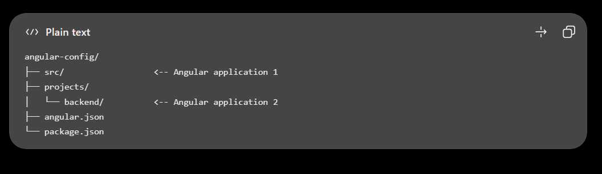

browserslist file

ng update

    We analyzed your package.json, there are some packages to update:
     to update
     ------------------------------------------------------------------------
      @angular/cli               21.2.29 -> 22.2.5        ng update @angular/cli
      @angular/core              21.2.25 -> 22.2.4        ng update @angular/core
      @angular/material          21.2.14 -> 22.2.5        ng update @angular/material
      angular-eslint             21.4.0 -> 22.6.0         ng update angular-eslint

ng generate application backend

ctrl+shift+v

ng serve angular-config
ng serve backend

ng build angular-config
ng build backend

ng generate library my-button
